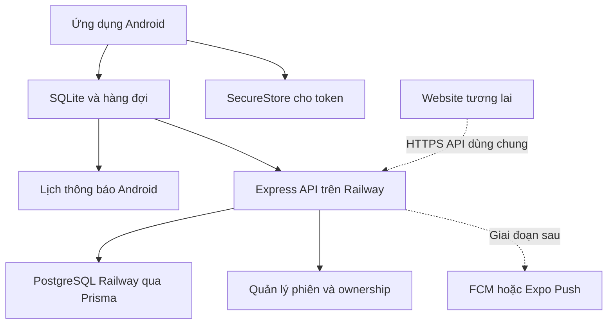

# DingDongNote — Đặc tả sản phẩm và triển khai

Phiên bản 1.1 · 16/11/2026 · Chủ sản phẩm Đoàn Đình Đông

## 0. Trạng thái và cách sử dụng

Tài liệu phục vụ ứng dụng Android cá nhân, có hướng phát hành Google Play và mở rộng SaaS. Đây là nguồn tham chiếu chính khi triển khai. Chưa có mã ứng dụng được triển khai hoặc kiểm thử cùng tài liệu này.

**Đã duyệt ngày 16/11/2026.** Chủ sản phẩm chọn nhắc thường cho MVP, xác nhận backend và cơ sở dữ liệu trung tâm trên Railway để website tương lai dùng chung, sử dụng điện thoại OPPO và duyệt các phương án còn lại trong danh sách quyết định. Các quy tắc nghiệp vụ và thiết kế triển khai dưới đây là baseline đã duyệt. Codex được lựa chọn phiên bản tương thích và xử lý chi tiết triển khai trong phạm vi này.

MVP đã đủ quyết định để bắt đầu code. Thông tin vận hành như model OPPO, Android/ColorOS cụ thể, tài khoản dịch vụ và thông tin đăng nhập được thu thập khi đến bước cần dùng. Việc chọn nhà cung cấp email và phát hành Play thuộc giai đoạn sau.

### Mục lục

1. [A. Tổng quan](#1-a-tổng-quan)
2. [B. Phạm vi](#2-b-phạm-vi)
3. [C. Màn hình và luồng](#3-c-màn-hình-và-luồng)
4. [D. UI và UX](#4-d-ui-và-ux)
5. [E. Kiến trúc](#5-e-kiến-trúc)
6. [F. Dữ liệu](#6-f-dữ-liệu)
7. [G. API](#7-g-api)
8. [H. Bảo mật](#8-h-bảo-mật)
9. [I. Thông báo](#9-i-thông-báo)
10. [J. Triển khai](#10-j-triển-khai)
11. [K. Lộ trình và nghiệm thu](#11-k-lộ-trình-và-nghiệm-thu)
12. [L. Quyết định và rủi ro](#12-l-quyết-định-và-rủi-ro)
13. [Quy tắc phát triển](#13-quy-tắc-phát-triển)
14. [Prompt cho Codex](#14-prompt-cho-codex)
15. [Nguồn tham chiếu](#15-nguồn-tham-chiếu)

## 1. A. Tổng quan

**Xác nhận** — Tên DingDongNote. Người dùng đầu tiên là chủ sản phẩm. App ghi chú, quản lý công việc, theo dõi thói quen và tài chính cá nhân. Giao diện đẹp, tạo động lực. Công việc và thói quen có giờ nhắc, âm thanh, rung và thông báo trên điện thoại, theo chế độ nhắc thường trong MVP.

Giá trị hướng tới là ghi nhanh khi đang bận, biết hôm nay cần làm gì và xem lại tiến bộ. Buổi sáng chọn việc, ban ngày ghi ý tưởng và chi tiêu, buổi tối đánh dấu và xem lại. Chỉ số đánh giá thử nghiệm là dùng được liên tục bảy ngày, ghi thu chi trong khoảng mười giây, tìm lại ghi chú và hoàn thành tác vụ từ thông báo.

## 2. B. Phạm vi

| Mã | Chức năng | Ưu tiên | Phạm vi đã duyệt |
|---|---|---|---|
| HOME | Hôm nay, việc chính, thói quen, tổng chi | P0 | MVP |
| NOTE | Ghi chú văn bản, tìm kiếm, ghim, sửa, xóa | P0 | MVP |
| TASK | Tạo việc, ngày làm, hạn chót, ưu tiên, hoàn thành, nhắc | P0 | MVP |
| HABIT | Lặp theo ngày trong tuần, tích từng ngày, lịch sử tuần | P0 | MVP |
| MONEY | Thu chi nhập tay, danh mục, tổng ngày/tháng | P0 | MVP |
| REMIND | Thông báo có tiếng, rung, hoàn thành, nhắc lại | P0 | MVP |
| ALARM | Chuông liên tục, dừng, báo lại | P2 | Sau MVP |
| ACCOUNT | Tài khoản riêng và dữ liệu trên server | P0 | MVP |
| OFFLINE | Xem và ghi khi mất mạng, đồng bộ lại | P0 | MVP |
| EXPORT | Xuất dữ liệu và xóa tài khoản | P1 | Trước phát hành công khai |
| THEME | Dark Mode, tùy biến màu | P2 | Sau MVP |
| PUSH | Push server, nhiều thiết bị | P2 | Sau MVP |
| GROWTH | Mục tiêu, biểu đồ dài hạn, Pomodoro | P2 | Sau khi dùng thực tế |

Ngoài phạm vi khởi đầu gồm thanh toán thuê bao, AI, nhóm cộng tác, kết nối ngân hàng, đầu tư, nhiều loại tiền, tệp đính kèm, chia sẻ công khai và iOS. Mở rộng SaaS giữ ownership theo user từ đầu. Chỉ bổ sung billing và quyền gói khi đã có yêu cầu.

### 2.1 Quy tắc ghi chú

Tiêu đề tối đa 200 ký tự, nội dung tối đa 50.000 ký tự. Cho phép thiếu tiêu đề nếu có nội dung, hiển thị dòng đầu làm tiêu đề. Nội dung thuần văn bản, giữ xuống dòng. Tìm theo tiêu đề và nội dung, không phân biệt hoa thường. Tìm bỏ dấu là P2. Ghim lên đầu, phần còn lại theo lần sửa gần nhất. Tự lưu bản nháp cục bộ, hiện rõ trạng thái lưu. Chuyển thành công việc tạo bản sao tiêu đề và liên kết noteId, giữ ghi chú gốc.

### 2.2 Quy tắc công việc

Task có title, description, plannedDate, dueAt tùy chọn, priority normal/high, status pending/completed, completedAt. Ngày dự kiến làm và hạn chót là hai trường riêng. Có thể tạo việc chưa có ngày. Mỗi ngày tối đa một việc được chọn làm việc chính. Hoàn thành trước giờ nhắc hủy nhắc tương ứng. Mở lại task không tự phát lại thông báo quá khứ. Việc chưa xong của hôm qua nằm trong mục cần sắp xếp, người dùng chọn ngày mới. Task lặp định kỳ thuộc P2, thói quen xử lý lặp ở MVP.

### 2.3 Quy tắc thói quen

Tên tối đa 120 ký tự, chọn một hoặc nhiều thứ trong tuần, ngày bắt đầu, một giờ nhắc tùy chọn, múi giờ IANA. MVP đánh dấu có/không, một lần hoàn thành mỗi ngày theo múi giờ thói quen. Tích lại để hoàn tác. Cho phép sửa lịch sử bảy ngày gần nhất, không tích ngày tương lai. Tỷ lệ tuần lấy số ngày hoàn thành chia số ngày đã đến hạn trong lịch tuần, loại ngày nghỉ và ngày trước khi bắt đầu. Thay đổi lịch có hiệu lực từ ngày tiếp theo, giữ lịch sử và mẫu lịch cũ. Lưu trữ thói quen ngừng nhắc, giữ lịch sử.

### 2.4 Quy tắc tài chính

VND và một sổ thu chi cá nhân. Mỗi giao dịch có loại income/expense, số tiền nguyên dương, danh mục, ngày giao dịch, ghi chú tùy chọn. Thu và chi lưu số dương, loại quyết định phép cộng tổng. Tổng thu trừ tổng chi là chênh lệch kỳ, chưa được gọi là số dư tài khoản. Số dư đầu kỳ, ví và chuyển khoản giữa ví thuộc P2. Sửa hoặc xóa giao dịch cập nhật tổng ngay. Danh mục đã dùng chỉ lưu trữ, giữ tên trong lịch sử. Số tiền API là chuỗi số nguyên, PostgreSQL BIGINT, tránh sai số JavaScript. Giới hạn 1–999.999.999.999 VND/giao dịch.

## 3. C. Màn hình và luồng

Thanh điều hướng dưới gồm Hôm nay, Công việc, Thói quen, Ghi chú, Tài chính. Avatar mở Cài đặt. Nút thêm nằm trong vùng dễ bấm và mở ghi nhanh theo loại.

| Màn hình | Nội dung và hành động |
|---|---|
| Khởi động | Khôi phục phiên và dữ liệu máy, không giữ splash khi chờ mạng |
| Đăng nhập | Email, mật khẩu, lỗi trường, hướng dẫn khôi phục tài khoản cá nhân |
| Hôm nay | Ngày, việc chính, việc còn lại, thói quen hôm nay, chi hôm nay |
| Danh sách công việc | Hôm nay, sắp tới, chưa lên lịch, hoàn thành, lọc |
| Chi tiết công việc | Sửa trường, nhắc, hoàn thành, xóa |
| Thói quen | Danh sách hôm nay, lịch bảy ngày, tạo/sửa/lưu trữ |
| Ghi chú | Tìm, ghim, xem, sửa, chuyển thành task |
| Tài chính | Tổng tháng, danh sách theo ngày, bộ lọc, thêm/sửa giao dịch |
| Cài đặt | Múi giờ, quyền nhắc, âm thanh, đồng bộ, tài khoản |
| Chẩn đoán thông báo | Quyền thông báo, exact alarm, channel, lịch đã đăng ký, thử nhắc |
| Báo thức liên tục | Màn hình giai đoạn sau MVP |
| Quyền riêng tư | Xuất dữ liệu, xóa tài khoản, liên kết chính sách trước public |

Bản cá nhân tạo tài khoản chủ bằng lệnh quản trị chạy trên backend, nhận email và mật khẩu qua nhập bảo mật, hash trước khi lưu. Đăng nhập thành công mở Hôm nay. Luồng đăng ký công khai được bổ sung khi mở sản phẩm. Phiên hết access token được refresh một lần có điều phối, lỗi refresh chuyển đăng nhập và giữ dữ liệu chưa đồng bộ theo đúng user. Đăng xuất hủy nhắc của user, thu hồi phiên khi có mạng, xóa token và cache sau khi xử lý dữ liệu chờ. Nếu còn dữ liệu chờ, cho chọn đồng bộ trước hoặc xác nhận xóa bản chưa gửi. Không để người đăng nhập tiếp theo thấy dữ liệu cũ.

Tạo công việc → lưu local → xếp lịch local → đưa vào hàng đợi đồng bộ → báo trạng thái. Tích từ thông báo thực hiện cùng logic hoàn thành trong màn hình. Nhắc lại tạo một lần nhắc sau mười phút cho đúng occurrence, không thay giờ gốc của các ngày sau. Ghi thu chi mở bàn phím số, mặc định ngày hiện tại và danh mục gần dùng.

Mọi màn có skeleton khi chưa có cache, empty state kèm nút tạo, lỗi có retry giữ dữ liệu nhập, offline hiển thị trạng thái chờ. Nút lưu chống double tap. Xóa có xác nhận, thao tác thất bại không hiển thị hoàn tất. Thông báo trỏ đến mục đã xóa hiển thị thông tin mục không còn tồn tại.

## 4. D. UI và UX

trắng ấm #FAF9F6, tím chính #6D4AFF, chữ #20202A, chữ phụ #656575, lỗi #B42318, thành công #16794B. Dùng Inter có tiếng Việt, fallback font hệ thống. Cỡ thân bài 16, chú thích 13–14, tiêu đề 22–28. Spacing theo 4/8/12/16/24/32, bo góc 12–16. Kiểm tra tương phản thực tế từng cặp màu, chữ thường tối thiểu 4.5:1.

Component dùng lại gồm Button, TextField, MoneyInput, DateTimePicker, TaskRow, HabitRow, NoteCard, TransactionRow, EmptyState, ErrorState, BottomSheet, ConfirmDialog, SyncStatus. Touch target tối thiểu 48dp, hỗ trợ TalkBack, font scale và reduce motion. Trạng thái có nhãn hoặc biểu tượng ngoài màu. Test màn 360dp, 412dp, tablet và bàn phím mở, safe area đầy đủ.

Hoàn thành có hiệu ứng nhỏ tùy giảm chuyển động. Hiện tiến bộ dạng 4/7 ngày, không dùng thông báo gây tội lỗi. Không tự phát câu động lực liên tục. Dark Mode P2 nhưng màu dùng token từ đầu. Màn khóa mặc định hiện “DingDongNote có lời nhắc”. Bật chế độ private của Android với nội dung công khai chung, kiểm tra trên OPPO. Sau mở khóa có thể xem nội dung và thao tác. Nếu hệ điều hành không hỗ trợ phân biệt an toàn, dùng nội dung chung và mở chi tiết sau xác thực thiết bị.

## 5. E. Kiến trúc

Stack đã duyệt là React Native + Expo + TypeScript + Expo Router, Node.js + Express + TypeScript, Prisma + PostgreSQL, Railway, GitHub private, Expo EAS. Chọn phiên bản stable tương thích tại lúc khởi tạo, khóa lockfile, ghi phiên bản thực dùng. Không đoán latest trong tài liệu.



monorepo npm workspaces gồm apps/mobile, apps/api, packages/contracts, spec.md. Contracts chứa kiểu và validation dùng chung. Mobile quản lý giao diện, cache, lịch nhắc và bản ghi offline. Server xác thực, kiểm tra ownership, validation, tổng hợp, persistence và giải quyết version. Mobile chỉ gọi HTTPS API, không giữ DATABASE_URL.

### 5.0 Railway và website dùng chung

Toàn bộ backend vận hành và cơ sở dữ liệu trung tâm nằm trên Railway, gồm API, tài khoản, ghi chú, công việc, lịch thói quen, thu chi và dữ liệu đồng bộ. SQLite trên điện thoại lưu cache, bản nháp, outbox và trạng thái lịch nhắc để dùng offline. Dữ liệu đã đồng bộ được lưu trong PostgreSQL Railway.

Website tương lai dùng cùng /api/v1, user ID, ownership và PostgreSQL. Quy tắc nghiệp vụ dùng chung nằm trong backend. Website là client mới, tái sử dụng contracts. API giữ version và kiểm tra conflict cho cả web/mobile. Trước triển khai website cần bổ sung CORS allowlist, cơ chế phiên trình duyệt bằng cookie HttpOnly/Secure phù hợp cùng CSRF protection, và đồng bộ thay đổi lịch nhắc về điện thoại. MVP đồng bộ khi mở/resume app, cập nhật từ web khi app đang đóng thuộc giai đoạn có push. Hosting frontend website quyết định khi làm website.

### 5.1 Offline và đồng bộ

SQLite lưu bản sao dữ liệu user cùng outbox. Một transaction local cập nhật đối tượng và thêm mutation có UUID. Server là bản dữ liệu chuẩn sau đồng bộ. Mỗi mutation mang entityId, mutationId, baseVersion và payload. Server kiểm tra version, ghi entity và kết quả mutation trong cùng transaction. Retry cùng mutationId trả kết quả cũ, không thêm giao dịch hoặc completion lần hai. Cùng mutationId khác payload trả 409.

MVP dùng pull snapshot đầy đủ phân trang sau mỗi đợt push và khi mở app. Snapshot có snapshotId và expiration, giữ ảnh dữ liệu nhất quán trong quá trình lấy trang. Chỉ thay cache sau khi tải đủ, giữ overlay các mutation còn chờ. Nếu snapshot hết hạn tải lại. Với quy mô cá nhân chấp nhận chi phí này, delta sync là P2. Không dùng updatedAt làm cursor đồng bộ có nguy cơ bỏ sót.

Conflict version trả 409 kèm bản server, cho người dùng chọn bản máy hoặc server. Chọn bản máy gửi mutation mới trên version server, không tự ghi đè im lặng. Xóa có tombstone để tránh hồi sinh dữ liệu. Outbox xử lý theo thứ tự phụ thuộc, note tạo trước task liên kết note, category trước transaction. Retry exponential backoff có jitter, 401 refresh, 400 dừng và báo, 409 chờ xử lý. Không phụ thuộc background JavaScript luôn chạy.

## 6. F. Dữ liệu

Mọi ID dùng UUID. Bảng nội dung có user_id FK, created_at/updated_at UTC, version integer tăng mỗi mutation, deleted_at nullable. Ngày lịch là DATE, thời điểm là TIMESTAMPTZ. FK liên kết nội dung phải đảm bảo cùng user bằng composite FK hoặc kiểm tra trong transaction.

| Bảng | Trường chính và ràng buộc |
|---|---|
| users | id PK, email_normalized UNIQUE, password_hash, display_name, timezone, created_at |
| sessions | id PK, user_id FK, refresh_hash UNIQUE, family_id, expires_at, revoked_at, device_label |
| notes | common, title, body, pinned boolean |
| tasks | common, title, description, planned_date, due_at, priority, status, completed_at, note_id nullable |
| daily_focus | user_id + local_date PK, task_id FK cùng owner |
| habits | common, name, start_date, archived_at |
| habit_schedules | id PK, habit_id FK, valid_from, valid_to nullable, weekdays, reminder_time nullable, timezone, mode |
| habit_completions | common, habit_id FK, local_date, completed_at, UNIQUE(user_id,habit_id,local_date) |
| categories | common, name, type income/expense, archived_at |
| transactions | common, category_id FK, type, amount BIGINT CHECK >0, currency VND, transaction_date, note |
| task_reminders | common, task_id FK, scheduled_at, timezone, mode, enabled |
| processed_mutations | user_id + mutation_id PK, payload_hash, response_json, created_at |
| sync_snapshots | id PK, user_id FK, expires_at, snapshot dữ liệu nhất quán |
| account_tokens (giai đoạn công khai) | id PK, user_id FK, token_hash, purpose verify/reset, expires_at, used_at |

Thiết bị lưu riêng notification_jobs với OS notification ID, entity ID, occurrenceKey, scheduledAt, mode, state và userId. Lưu outbox, schema_version và drafts trong SQLite. Push token server chỉ thêm bảng devices khi triển khai push.

Index theo (user_id,updated_at,id), tasks(user_id,planned_date,status), transactions(user_id,transaction_date,id), notes(user_id,pinned,updated_at), habit_completions(user_id,local_date). Email lowercase và trim trước unique. Habit schedule không được chồng khoảng hiệu lực. Transaction type phải khớp category type. Completed task phải có completedAt, pending phải null. Delete note đặt note_id null, giữ task. Delete habit giữ lịch sử cho tới khi purge theo chính sách đã duyệt.

Migration dùng Prisma migrate dev ở dev và migrate deploy cho môi trường đã triển khai. Commit migration có review. Không db push lên production. Migrations SQLite tăng tuần tự và transaction khi phù hợp. Trước migration phá hủy cần backup, phương án restore và chủ sản phẩm phê duyệt. Backup hằng ngày, giữ bảy bản ngày và bốn bản tuần, kiểm thử restore sang DB riêng. Mục tiêu RPO 24h, RTO 4h, triển khai trong ngân sách đã duyệt. Không coi backup chưa thử restore là đã nghiệm thu.

## 7. G. API

Base /api/v1, JSON UTF-8, thời điểm ISO 8601 UTC, ngày YYYY-MM-DD. Auth Bearer access token. Server lấy user từ token, không tin userId do client gửi. Các route lấy ID của người khác trả 404. Pagination limit mặc định 50, tối đa 100, cursor opaque theo sort ổn định.

| Method | Endpoint | Chức năng |
|---|---|---|
| POST | /auth/register | Tạo tài khoản nếu đăng ký được bật |
| POST | /auth/login | Email và mật khẩu → phiên |
| POST | /auth/refresh | Refresh token → cặp token mới |
| POST | /auth/logout | Thu hồi phiên |
| POST | /auth/forgot-password | Giai đoạn công khai, yêu cầu reset email và phản hồi chung |
| POST | /auth/reset-password | Giai đoạn công khai, token một lần và mật khẩu mới |
| GET/PATCH | /me | Hồ sơ, timezone |
| DELETE | /me | Xóa tài khoản, yêu cầu xác thực lại |
| GET | /me/export | Xuất JSON dữ liệu thuộc user |
| GET/POST | /notes, /tasks, /habits, /categories, /transactions | List hoặc tạo |
| GET/PATCH/DELETE | /{resource}/{id} | Chi tiết, sửa, xóa |
| PUT/DELETE | /focus/{date} | Chọn hoặc bỏ việc chính |
| PUT/DELETE | /habits/{id}/completions/{date} | Hoàn thành hoặc hoàn tác |
| PUT | /habits/{id}/schedule | Thay lịch có hiệu lực từ ngày sau |
| PUT/DELETE | /tasks/{id}/reminder | Đặt hoặc bỏ nhắc |
| GET | /summary/today?date=... | Tổng hợp ngày |
| GET | /summary/finance?month=YYYY-MM | Thu, chi, chênh lệch, theo nhóm |
| POST | /sync/mutations | Gửi tối đa 50 mutations theo thứ tự |
| POST | /sync/snapshots | Tạo snapshot nhất quán |
| GET | /sync/snapshots/{id}?cursor=... | Lấy các trang snapshot |
| GET | /health/live, /health/ready | Liveness, readiness DB |

Resource thay {resource} bằng notes/tasks/habits/categories/transactions. List hỗ trợ cursor/limit, notes thêm q, tasks thêm status/from/to, transactions thêm from/to/type/categoryId. Snapshot chỉ chứa dữ liệu nội dung, tuyệt đối loại credentials và session.

Mutation đi qua REST hoặc sync đều dùng chung service, kiểm tra baseVersion và idempotency. REST tạo/sửa/xóa yêu cầu Idempotency-Key, sửa/xóa gửi baseVersion. Sync trả kết quả từng mutation, không giả định cả batch thành công. Entity version bắt đầu 1, create baseVersion 0. Xóa trả tombstone version mới.

Ví dụ tạo giao dịch qua POST /transactions, header Idempotency-Key là UUID mới.

```json
{"id":"6b2857d8-372b-4af4-a155-d8c28d579120","type":"expense","amount":"35000","currency":"VND","categoryId":"21c8a1d2-e181-4cdd-aedb-5f615c2725cc","transactionDate":"2026-11-16","note":"Cà phê","baseVersion":0}
```

```json
{"data":{"id":"6b2857d8-372b-4af4-a155-d8c28d579120","type":"expense","amount":"35000","currency":"VND","transactionDate":"2026-11-16","version":1},"meta":{"requestId":"req_example"}}
```

Ví dụ hoàn thành task PATCH /tasks/{id}.

```json
{"status":"completed","baseVersion":3}
```

Server gán completedAt, trả bản task đầy đủ với version 4. Request tạo note gồm id/title/body/pinned/baseVersion, task gồm id/title/description/plannedDate/dueAt/priority/baseVersion, habit gồm id/name/startDate/baseVersion. Schedule có weekdays ISO 1–7, time HH:mm, timezone và mode notification trong MVP. Category có id/name/type/baseVersion. Validation áp dụng giới hạn mục 2 và whitelist trường.

```json
{"error":{"code":"VERSION_CONFLICT","message":"Dữ liệu đã thay đổi","fields":{},"details":{"currentVersion":4}},"meta":{"requestId":"req_example"}}
```

Status gồm 200/201 thành công, 400 input, 401 hết phiên, 403 không đủ quyền hành động, 404 không tìm thấy, 409 conflict, 429 rate limit, 500 lỗi nội bộ. Response list có data array, meta.nextCursor. Auth login request email/password, response accessToken/expiresIn/refreshToken/user. Không log token. Trước viết client tạo OpenAPI cho mọi endpoint với schema request/response, lỗi và example, khớp contracts. Không đổi ngầm hợp đồng API.

## 8. H. Bảo mật

email + mật khẩu, access JWT 15 phút, refresh opaque 30 ngày, refresh rotation và thu hồi theo family khi phát hiện reuse. Client single-flight refresh và lưu token mới nguyên tử. Server serialize refresh trong transaction, có chiến lược retry mất response được kiểm thử, tránh vô tình khóa phiên khi mạng chập chờn. Refresh lưu hash server, token máy dùng SecureStore, access chỉ giữ memory. JWT kiểm tra signature, algorithm allowlist, issuer, audience và exp.

Password dùng Argon2id, baseline OWASP 19 MiB, 2 iterations, parallelism 1 và benchmark trên máy triển khai. mật khẩu 12–128 ký tự, cho phép password manager, không log hoặc cắt mật khẩu âm thầm. Reset token ngẫu nhiên một lần, hash server, hết hạn 30 phút, reset thu hồi các phiên. Bản cá nhân khôi phục bằng lệnh quản trị tại backend qua quyền truy cập Railway của chủ sản phẩm, nhập mật khẩu mới bảo mật, hash và thu hồi mọi phiên. Màn Quên mật khẩu hướng dẫn quy trình này. Provider email và xác minh email được chọn khi chuẩn bị mở đăng ký công khai. Endpoint forgot/reset qua email và bảng account_tokens triển khai ở giai đoạn đó.

Rate limit login 5 lần/phút theo IP và email, API 120 lần/phút/user, payload tối đa 256 KB. Điều chỉnh dựa trên đo đạc, không làm lộ email tồn tại. MVP một replica có thể dùng limiter memory, trước nhiều replica cần shared store đã phê duyệt. Ownership kiểm tra mọi list, detail, aggregate, export và mutation. Dùng parameterized query/Prisma, tránh raw SQL ghép chuỗi.

TLS production, secrets nằm Railway/EAS secret, chỉ API URL công khai dùng EXPO_PUBLIC_. Không nhúng API key AI, DB password, JWT secret hoặc FCM service account vào APK. SecureStore dành cho bí mật nhỏ, SQLite không mặc nhiên mã hóa. Mã hóa riêng nội dung SQLite thuộc giai đoạn sau MVP. Ngăn Android backup khôi phục token không còn hợp lệ, kiểm tra cấu hình backup và chính sách lưu local.

xóa tài khoản purge dữ liệu hoạt động trong bảy ngày, backup hết hạn tối đa 35 ngày, phản ánh đúng chính sách. Reauthentication trước xóa và export nhạy cảm. Đăng ký công khai tắt cho bản cá nhân, mở sau khi kiểm thử account isolation và cơ chế khôi phục tài khoản.

## 9. I. Thông báo

### 9.1 Phân biệt yêu cầu và khả năng kỹ thuật

MVP dùng expo-notifications để nhắc thường có âm thanh ngắn, rung và thông báo trên thanh trạng thái. Action gồm Đã xong/Đã làm và Nhắc lại sau 10 phút. Chuông liên tục và giao diện toàn màn hình thuộc P2.

Xin quyền thông báo theo Android thực tế. Khi SDK yêu cầu quyền exact alarm để nhắc đúng giờ, kiểm tra và hướng dẫn cấp quyền trong ngữ cảnh đặt lịch. Khi quyền bị từ chối, thể hiện trạng thái và khả năng nhắc thực tế, tránh báo lịch nhắc đã sẵn sàng nếu chưa lập lịch được. MVP sử dụng thông báo thông thường. Các nguồn chính thức ở mục 15.

### 9.2 Quy tắc nhắc

Tạo channel tasks và habits với tiếng ding-dong đóng gói trong app, rung, importance phù hợp. Android cho người dùng điều khiển channel, đổi sound có thể cần channel ID phiên bản mới. Không ghi đè lựa chọn hệ thống của người dùng. Xin quyền trong ngữ cảnh người dùng bật nhắc, từ chối vẫn dùng được app, hiển thị trạng thái nhắc bị tắt và đường mở Settings.

Task nhắc một lần theo instant đã chọn. Habit nhắc theo giờ địa phương và timezone cố định của schedule. Đổi timezone thiết bị không tự đổi lịch, hỏi hoặc cho chọn cập nhật timezone trong Cài đặt. Khi DST có giờ không tồn tại chọn thời điểm hợp lệ kế tiếp, giờ lặp chọn lần đầu. Quy tắc này cần test dù bản đầu chủ yếu Asia/Ho_Chi_Minh.

OccurrenceKey gồm userId/entityId/localDate/scheduleVersion. Hoàn thành habit hủy occurrence hôm nay, giữ các ngày sau. Vuốt thông báo không hoàn thành. Snooze thay lần snooze cũ của cùng occurrence, không tạo chuỗi bản sao. Action phải idempotent, kiểm tra mục chưa xóa và đúng user. Cold start từ notification phải đợi khôi phục user/cache trước navigation.

### 9.3 Chạy nền và đối soát

Lập lịch bằng OS, không dùng setInterval làm đồng hồ báo thức. Đối soát notification_jobs với lịch OS khi mở app, resume, sửa lịch, hoàn thành, xóa, đổi quyền và đăng xuất. Hủy lịch cũ trước tạo lịch thay thế với trạng thái có thể retry. Khởi động lại máy cần thử việc phục hồi của SDK được chọn, bổ sung native receiver nếu cần và được duyệt.

Thói quen chưa hoàn thành phải tiếp tục nhắc khi nhiều ngày không mở app. Thử recurring trigger hỗ trợ theo tuần và khả năng bỏ riêng occurrence đã hoàn thành. Nếu SDK không đáp ứng bỏ occurrence mà giữ lần tiếp theo, cần thiết kế native recurrence hoặc chốt hạn chế rõ với chủ sản phẩm. Không nghiệm thu bằng cách xếp lịch bảy ngày rồi âm thầm ngừng nhắc.

Phân biệt app background, swipe khỏi recent và force-stop trong Settings. Force-stop, quyền bị thu hồi, máy tắt, DND, âm lượng và tối ưu pin OEM có thể chặn/trễ nhắc. Không cam kết kêu trong mọi trạng thái. Khi mở lại hiển thị việc quá giờ và phục hồi lịch tương lai, không phát hàng loạt chuông quá khứ. Test thiết bị thật, development/release build. Push server P2 và không dùng như bảo đảm báo thức chính xác.

### 9.4 Ma trận nghiệm thu

Test foreground/background/khóa màn hình/swipe recent/reboot/offline/force-stop và mở lại, từ chối quyền, DND, channel mute, sửa giờ, xóa mục, hoàn thành sớm, snooze liên tiếp, bấm action hai lần, đổi ngày/timezone và tuần mới. Ghi model máy, Android, SDK, quyền, giờ dự kiến/thực tế và kết quả. Thiết bị nghiệm thu chính là OPPO của chủ sản phẩm. Ghi model, Android và ColorOS khi chạy thử, kiểm tra thiết lập thông báo màn khóa, hoạt động nền và pin theo đúng máy. Model cụ thể được lấy ở bước kiểm thử. Có thể bổ sung emulator cho phiên bản Android hỗ trợ.

## 10. J. Triển khai

Dev dùng backend và DB riêng trên Railway cùng build development trên máy phát triển. Staging tách DB/secrets khỏi production. Production một Express service Railway và PostgreSQL có persistent volume, kết nối mạng private khi cùng project. API bind 0.0.0.0 và PORT Railway. Build npm ci rồi build workspace, start JS biên dịch. Migration là bước kiểm soát trước release, health ready sau kết nối DB. Không mở Postgres trực tiếp cho app.

Env backend gồm NODE_ENV, PORT, DATABASE_URL, JWT_SECRET hoặc signing keys, JWT_ISSUER, JWT_AUDIENCE, ACCESS_TOKEN_TTL, REFRESH_TOKEN_TTL, REGISTRATION_ENABLED, LOG_LEVEL và mail secrets khi dùng. Mobile gồm EXPO_PUBLIC_API_URL, EAS project config, applicationId com.dingdongnote.app. .env.example chỉ placeholder. Mọi môi trường có cấu hình độc lập.

GitHub private, main ổn định, nhánh feature nhỏ và PR tự review. CI chạy typecheck, lint, test liên quan và build. Không tự deploy production khi push. EAS profiles development, preview APK để cài cá nhân, production AAB để gửi Play. Giữ signing key an toàn, tăng versionCode mỗi upload, kiểm tra package ID duy nhất trước build public.

Trước Play kiểm tra target API đang yêu cầu, account verification, testing track cho loại tài khoản, privacy policy, Data safety, account deletion trong app và web khi áp dụng, store listing, content rating, khai báo permission và license âm thanh. Các chính sách cần đối chiếu lại ở thời điểm submit. Chủ sản phẩm phải cho phép tạo tài nguyên trả phí và xuất bản production.

Logging JSON có requestId, status, duration, loại lỗi, không ghi nội dung note/mật khẩu/token hoặc thu chi. Theo dõi health, crash, tỷ lệ 5xx, latency, DB connections, dung lượng, backup và lỗi đồng bộ. MVP dùng log Railway và log lỗi ứng dụng đã loại dữ liệu nhạy cảm. Dịch vụ crash monitoring bên thứ ba được chọn khi cần mở rộng. Rollback API dùng bản trước tương thích schema, migration destructive cần restore hoặc forward fix theo runbook.

Chi phí là dự trù, cần duyệt trước mua. Railway Hobby được trang giá kiểm tra ngày 16/11/2026 niêm yết mức tối thiểu $5/tháng có $5 usage, phát sinh vượt theo tài nguyên. ngân sách tối đa $25/tháng cho API + DB cá nhân, kiểm tra usage sau tuần đầu, đặt cảnh báo ở mức 80% nếu nền tảng hỗ trợ. Đây là giới hạn kế hoạch, cần theo dõi usage để kiểm soát thực tế. Backup, egress, email, tên miền, EAS và Play Console tính riêng theo bảng giá lúc đăng ký. Chưa đưa ra tổng chi phí cam kết. Scale bằng đo query/index/pooling trước, tăng tài nguyên rồi replica nếu cần, tránh thêm Redis/queue/microservices sớm.

## 11. K. Lộ trình và nghiệm thu

| Giai đoạn | Mục tiêu và công việc | Phụ thuộc | Tiêu chí xong |
|---|---|---|---|
| 0. Chốt | Đã duyệt phạm vi và quyết định ở L | Đã hoàn thành | Bắt đầu triển khai giai đoạn 1 |
| 1. Khởi tạo | Monorepo, TS, Expo Router, Express, env example, CI | 0 và cho phép code | Mobile mở được, health API chạy, không secrets |
| 2. UI | Token, components, navigation, màn mẫu và states | 1 | Kiểm trên điện thoại, font lớn, bàn phím, empty/error |
| 3. Backend | Schema đã duyệt, migrations, auth, CRUD, ownership | 1 | API contracts và test hai user đạt |
| 4. Kết nối | SQLite, outbox, retry, snapshot, conflict | 2–3 | Mất mạng ghi được, retry không trùng và không mất dữ liệu |
| 5. Chức năng | Note/task/habit/finance và tổng hợp | 4 | Toàn bộ luồng mục 2–3 chạy end-to-end |
| 6. Thông báo | Channels, permissions, lịch, actions, snooze, thử OPPO | 5 | Ma trận mục 9 có kết quả và ngoại lệ rõ |
| 7. Kiểm thử | Security, regression, performance, accessibility | 5–6 | Không lỗi P0/P1, restore backup kiểm chứng |
| 8. Production | Railway, EAS preview, monitoring, runbook | 7, chủ cho phép | APK hoạt động với production, rollback rõ |
| 9. Google Play | Policy, AAB, listing, internal/closed track | 8, chủ cho phép | Đạt kiểm tra track và được chấp nhận phát hành |
| 10. Duy trì | Theo dõi lỗi, dùng bảy ngày, ưu tiên feedback | 8 hoặc 9 | Backlog dựa trên dùng thật và bảo trì định kỳ |

Test bắt buộc gồm tổng tiền chính xác, tháng ranh giới, timezone, habit denominator, task completion, ownership hai user, duplicate mutations, stale version, crash giữa local save và sync, refresh concurrency, delete rồi sync thiết bị cũ, đăng xuất có outbox và reminder reconciliation. Unit cho phép tính/lịch, integration DB/API, kiểm thủ công hoặc E2E cho hành trình quan trọng. Không gọi tính năng hoàn tất nếu chỉ typecheck.

## 12. L. Quyết định và rủi ro

| ID | Trạng thái | Quyết định |
|---|---|---|
| D01 | Đã duyệt | Android cá nhân, bốn module, Hôm nay và Ghi nhanh |
| D02 | Đã duyệt | Expo/React Native/Express/Prisma/PostgreSQL. Backend và DB trung tâm trên Railway, API sẵn sàng dùng chung cho website |
| D03 | Đã duyệt | Email/mật khẩu, một tài khoản cá nhân, đăng ký công khai đóng |
| D04 | Đã duyệt | Đọc/ghi offline, đồng bộ tự động khi có mạng, xung đột cho chọn bản, ưu tiên một điện thoại |
| D05 | Đã duyệt | Nhắc thường trong MVP. Chuông liên tục thuộc P2 |
| D06 | Đã duyệt | VND, một sổ thu chi thủ công. Ví và số dư đầu kỳ thuộc P2 |
| D07 | Đã duyệt | Trắng ấm/tím, Inter, một việc chính mỗi ngày. Dark Mode P2 |
| D08 | Đã duyệt | OPPO, APK cá nhân trước. Package com.dingdongnote.app. Codex chọn Android tối thiểu tương thích SDK, ghi lại và kiểm tra với máy chủ trước build cài đặt |
| D09 | Đã duyệt | Reset riêng qua lệnh quản trị backend. Email provider chọn khi mở đăng ký công khai |
| D10 | Đã duyệt | Trần dự trù API + DB $25/tháng, backup ngày/tuần theo mục 6, xóa dữ liệu theo mục 8 |
| D11 | Đã duyệt | Màn khóa hiện lời nhắc chung, SecureStore cho token, mã hóa thêm SQLite ở giai đoạn sau |
| D12 | Đã duyệt | Phạm vi MVP theo mục 2, bổ sung export/delete trước công khai, các tính năng mở rộng P2 |

Schema và API ban đầu được duyệt làm baseline để Codex triển khai migrations và contracts. Có thể hoàn thiện chi tiết kỹ thuật giữ nguyên hành vi đã duyệt. Khi phát hiện mâu thuẫn ảnh hưởng nghiệp vụ hoặc cần thay đổi schema đã triển khai, trình bày sửa đổi trước khi thực hiện.

Thông tin vận hành lấy đúng lúc cần gồm model OPPO, phiên bản Android/ColorOS, tài khoản Railway/GitHub/Expo, email chủ app và quyền triển khai. Thông tin Play và provider email cần khi chuẩn bị phát hành công khai. Những thông tin này không chặn khởi tạo code và các phần độc lập.

Rủi ro còn lại gồm giới hạn thông báo nền trên OPPO, xung đột offline và mutation gửi lại. Kiểm chứng trên máy thật, version conflict và idempotency là các biện pháp nghiệm thu. Cần theo dõi chi phí Railway thực tế. Chưa có ứng dụng chạy để kiểm chứng cùng bản đặc tả này.

## 13. Quy tắc phát triển

1. Đọc phần liên quan trong spec.md và kiểm tra code trước khi sửa.
2. Không tự đổi yêu cầu đã duyệt. cập nhật spec trước khi thay hành vi.
3. Đánh dấu TBD nghiệp vụ, hỏi phần chặn công việc, tiếp tục phần độc lập.
4. Không tự đổi schema đã duyệt, xóa dữ liệu, reset database hoặc deploy production.
5. Không hardcode secrets hoặc kết nối PostgreSQL từ Android.
6. API secret và logic phân quyền ở backend.
7. Làm từng tính năng nhỏ theo lộ trình, giữ code đơn giản và tái sử dụng logic.
8. Không viết lại toàn dự án để sửa lỗi nhỏ, không thêm stack thiếu phê duyệt.
9. Test hành vi quan trọng, ghi trung thực bước chưa chạy và lỗi tồn tại.
10. Sau mỗi tính năng báo file sửa, kiểm thử, kết quả, điểm còn thiếu và bước tiếp.
11. Nếu cần thiết bị, quyền tài khoản hoặc service trả phí, giải thích chính xác phần bị chặn.
12. Không coi dữ liệu mock, nút chưa xử lý hoặc màn đẹp là tính năng đã hoàn thành.
13. Chỉ commit/push/deploy khi được người dùng cho phép tương ứng.
14. Duy trì nhật ký quyết định trong spec, ghi ngày và lý do, không biến thành xác nhận.

## 14. Prompt cho Codex

Copy nguyên khối dưới vào Codex sau khi đặt spec.md tại thư mục gốc dự án.

```text
Bạn là kỹ sư phụ trách triển khai DingDongNote. Hãy đọc toàn bộ spec.md ở thư mục gốc cùng AGENTS.md nếu có, rồi kiểm tra code hiện tại. Dùng spec.md làm nguồn yêu cầu chính.

Phạm vi và quyết định D01–D12 đã được tôi duyệt. Hãy tóm tắt ngắn rồi bắt đầu triển khai theo lộ trình từ giai đoạn 1, đọc repository trước khi tạo hoặc sửa file. Chọn phiên bản stable tương thích, kiểm tra tài liệu chính thức và ghi phiên bản thực dùng. Schema ban đầu đã duyệt được triển khai bằng migrations.

MVP dùng nhắc thường có tiếng/rung/thanh thông báo, ưu tiên kiểm thử OPPO. Backend và PostgreSQL trung tâm trên Railway, API dùng chung cho website tương lai. Điện thoại có SQLite cho offline và outbox. Thiết kế và luồng tài khoản, tài chính, quyền riêng tư theo quyết định đã duyệt. Triển khai từng tính năng hoàn chỉnh và tự xử lý chi tiết kỹ thuật trong phạm vi này.

Chỉ hỏi thêm khi có thông tin vận hành thực sự cần ở bước hiện tại, thay đổi nghiệp vụ ngoài phạm vi, hoặc hành động cần quyền riêng như mua tài nguyên và deploy production. Các thông tin máy OPPO cụ thể có thể lấy khi chuẩn bị cài APK. Tiếp tục các phần độc lập nếu một phần bị chặn.

Mỗi lượt làm việc hãy đọc mục spec liên quan, kiểm tra hiện trạng, nêu kế hoạch ngắn, thực hiện phần đã được phép và chạy kiểm tra phù hợp. Tiếp tục xử lý lỗi có thể khắc phục trong phạm vi, không dừng ở lời đề xuất. Không tự deploy production, reset DB, xóa dữ liệu hoặc push GitHub khi chưa được phép.

Ưu tiên bảo toàn dữ liệu, ownership, tiền không sai số, retry không trùng, offline rõ trạng thái và lịch thông báo kiểm chứng được. Không cam kết báo thức hoạt động khi force-stop hoặc quyền hệ thống không cho phép. Không dùng mock để tuyên bố tính năng thật hoàn tất.

Sau mỗi tính năng, báo ngắn những gì đã làm, file thay đổi, lệnh kiểm tra và kết quả, lỗi/chưa kiểm chứng, bước tiếp theo. Giữ spec.md khớp các quyết định được duyệt. Bắt đầu bằng việc đọc file và kiểm tra repository ngay bây giờ.
```

## 15. Nguồn tham chiếu

Đã đối chiếu ngày 16/11/2026, cần kiểm tra lại theo phiên bản SDK và lúc phát hành.

- Expo Notifications, scheduling, channels và development build — https://docs.expo.dev/versions/latest/sdk/notifications/
- Android AlarmManager và quyền exact alarm — https://developer.android.com/develop/background-work/services/alarms
- Google Play full-screen intent — https://support.google.com/googleplay/android-developer/answer/13392821
- OWASP Password Storage — https://cheatsheetseries.owasp.org/cheatsheets/Password_Storage_Cheat_Sheet.html
- Railway pricing — https://railway.com/pricing

Nhật ký 1.0 — Tổng hợp ý tưởng và yêu cầu master, bổ sung offline/version/idempotency, làm rõ giới hạn báo thức, để các quyết định nghiệp vụ chưa duyệt ở TBD.

Nhật ký 1.1 — Chủ sản phẩm duyệt các phương án ngày 16/11/2026, chọn nhắc thường, xác nhận OPPO và Railway cho backend/DB dùng chung website. Cập nhật scope, quyền riêng tư, recovery, lộ trình và prompt triển khai.
